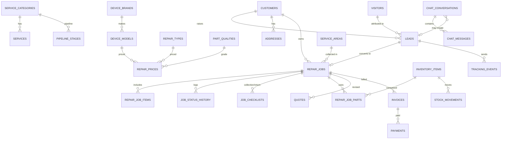

# Phase 0 — Plan for approval

**Project:** ZR Technologies Ltd: website, CRM and admin
**Source brief:** [`ZR_TECHNOLOGIES_BUILD_PROMPT.md`](../ZR_TECHNOLOGIES_BUILD_PROMPT.md)
**Status:** revision 2. Decisions D1–D3 answered, scope re-prioritised for a fast launch. Awaiting final go-ahead.
**Date:** 24/11/2026

This document covers the five things the brief asks for before any code: architecture overview, ERD and migration list, package list with versions, route map, and the phase plan. It adds design tokens, an asset map, environment findings and the decisions log (§9).

---

## 0. Owner decisions (revision 2)

| # | Decision | Consequence for the build |
|---|---|---|
| D1 | Latest PHP | **PHP 8.5** locally and on Hostinger. PHP 8.6.0 was released on 19/11/2026 but no host (including Hostinger) offers it yet, so 8.5 is the newest version we can run in production. All packages in §3 support it |
| D2 | Updated MySQL | **MySQL 8.4 LTS** locally. Hostinger shared hosting may use MariaDB, so all SQL and migrations stay portable (no MySQL-only syntax). Confirm the engine/version shown in hPanel → Databases |
| D3 | Hostinger shared hosting (hPanel) | No Redis, no Horizon, no always-on workers, no Node on the server. See §2.5 for how each part runs |
| Priority | **Run the business fast.** SEO-optimised website + well-built admin first; extras later | Phases re-ordered so the site **goes live at the end of Phase 5** (§7). The AI chatbot, AI blog assistant and MCP server move to "After launch" |

---

## 1. Environment findings (checked on this machine, 24/11/2026)

| Item | Found | Required / recommended | Impact |
|---|---|---|---|
| PHP | **8.3.36** (XAMPP) | Laravel 13 needs ^8.3 ✅. **Many current packages now need PHP 8.4** | See decision D1 |
| Composer | 2.10.1 | ✅ | |
| Node / npm | 20.19.4 / 11.9 | Vite 7 + Tailwind v4 need Node ≥ 20.19 ✅ | |
| Database | **MariaDB 10.4.32** (XAMPP) | Brief: MySQL 8 or MariaDB 10.11+. 10.4 has been end-of-life since 2024 | See decision D2 |
| Redis | **not installed** | Brief: Redis for cache, queues and sessions | Local: `database` drivers. Production: Redis |
| Horizon | Needs `pcntl`/`posix`, which don't exist on Windows | | Local: `php artisan queue:work`. Production (Linux): Horizon |
| PHP extensions | gd, intl, bcmath, curl, mbstring, zip, fileinfo, openssl ✅. **exif** missing, no imagick | exif lets the media library read photo orientation | Enable `extension=exif` in php.ini |
| Git | 2.45 ✅ | Folder is not a repo yet | `git init` at the start of Phase 1 |

### Current package versions vs PHP 8.3 (from Packagist, 24/11/2026)

Packages whose **latest** release needs PHP 8.4, with the newest release that still runs on 8.3:

| Package | Latest (PHP 8.4) | Newest on PHP 8.3 | What we lose on 8.3 |
|---|---|---|---|
| pestphp/pest | 5.3.7 | 4.7.8 | Pest 5 (v4 is fine) |
| spatie/image (used by medialibrary) | 3.9.10 | 3.9.7 | minor fixes |
| spatie/laravel-activitylog | 5.1.5 | 4.12.3 | v5 API; **pxlrbt/filament-activity-log v3 (Filament 5) needs PHP 8.4** |
| spatie/laravel-sitemap | 8.2.0 | 8.0.0 | minor |
| spatie/schema-org | 5.0.2 | 4.0.2 | major version behind |
| spatie/laravel-backup | 10.5.0 | 10.3.3 | minor |
| spatie/laravel-responsecache | 8.7.0 | 7.1.0 | **a full major version behind** |
| spatie/laravel-sluggable | 6.0.0 | 4.0.6 | not needed (we write our own slug handling) |

**Resolved (D1): PHP 8.5** locally and in production, which clears every constraint above. The plan uses the latest versions in §3.

---

## 2. Architecture overview

### 2.1 Shape

One Laravel 13 monolith, server-rendered, with two surfaces:

```
  Visitors (mobile-first)            Staff
          │                            │
          ▼                            ▼
┌─────────────────────────┐  ┌─────────────────────────┐
│ Public site             │  │ /admin                  │
│ Blade + Livewire v4     │  │ Filament v5 panel       │
│ Alpine + Tailwind v4    │  │ CRM · CMS · SEO · MFA   │
│ full-page cache         │  │                         │
└────────────┬────────────┘  └────────────┬────────────┘
             └──────────────┬─────────────┘
                            ▼
              ┌───────────────────────────┐
              │ Domain layer              │──▶ MySQL / MariaDB
              │ Actions · Services        │──▶ file cache, DB sessions
              │ Models · Enums · Events   │──▶ storage (public + private)
              └─────────────┬─────────────┘
                            │ database queue, run by cron every minute
                            ▼
        GA4 MP · Meta CAPI · mail · webhooks · postcodes.io

  After launch (the domain layer is already shaped for these):
    • AI chat widget (laravel/ai agent + tools)
    • MCP server for the owner's Claude (laravel/mcp)
```

### 2.2 Code organisation

Laravel-conventional folders, with business logic kept out of controllers, Livewire components and Filament resources so that the website and admin (and, after launch, the chatbot and MCP tools) all call **the same code**:

```
app/
  Actions/            Single-purpose operations, e.g. Booking/CreateBooking, Leads/CaptureLead,
                      Jobs/ChangeJobStatus, Customers/MergeCustomers, Customers/AnonymiseCustomer
  Ai/                 (after launch) SupportAgent, BlogAssistant + tools as thin wrappers over Actions/Services
  Data/               Typed DTOs (BookingData, AttributionData, PriceQuote)
  Enums/              LeadType, LeadStatus, JobStatus, Channel, PartQuality, ConsentCategory ...
  Events/ Listeners/  BookingCompleted, JobStatusChanged, JobCompleted → tracking, notifications, review requests
  Filament/           Resources, Pages (Settings, Tracking Health, Reports, Price Grid), Widgets, Clusters
  Http/               Controllers (public pages), Middleware (CaptureAttribution, Redirects, SecurityHeaders)
  Jobs/               SendMetaCapiEvent, SendGa4Event, UploadGoogleAdsConversion, RegenerateSitemaps, GenerateOgImage
  Livewire/           BookingWizard, PriceChecker, PostcodeChecker, QuickQuote, CallbackForm, ContactForm, TrackRepair
  Mcp/                (after launch) Servers/CrmServer, Tools/*, Resources/*
  Models/
  Notifications/      Customer + staff notifications; NotificationChannel abstraction (Slack/Telegram/WhatsApp webhook)
  Services/           Postcodes (postcodes.io), Pricing, Availability, Coverage, Seo (meta, schema, sitemaps),
                      Tracking (Attribution, ChannelResolver, Meta, Ga4, GoogleAds, Hasher), Ebay (interface + manual driver)
  Settings/           spatie/laravel-settings classes (§2.4)
  View/Components/    Blade design-system components
```

### 2.3 Key design decisions

1. **Verticals without rewrites.** `service_categories` (iPhone Repair, Accessories, Custom Printing, Web Development, IT Services, ...) each have a feature flag, a pillar page, a **pipeline** (its own lead stages) and a form type (booking wizard / quote form / enquiry form). iPhone repair is the first category. Its repair-specific tables (models, price matrix, jobs) live alongside generic CRM tables (leads, customers, tasks, communications), so adding "Web Development" means admin data, not code.
2. **Money in integer pence** (`price_pence`), formatted as £ in one helper. VAT fields exist from day one (`vat_rate`, `net/vat/gross`), switched on by a setting.
3. **One place for NAP and hours.** `BusinessSettings` feeds the header, footer, JSON-LD, emails, PDFs and (later) the chatbot system prompt. Nothing hard-coded.
4. **SEO metadata is polymorphic** (`seo_meta` morphs to page, post, repair type, device model, service area, video, category). A single `SeoResolver` merges, in order: record override → title pattern from settings → sensible default. One resolver also builds the JSON-LD graph.
5. **Thin-content protection is enforced in code:** model × repair pages and location pages are `noindex` + canonical-to-parent until they meet the unique-content checks (word count, similarity against siblings). Sitemaps include only indexable URLs.
6. **Attribution is server-side and first-party.** Middleware captures click IDs and UTMs into a `visitors` record keyed by a first-party cookie (90 days, first touch + last touch). Every lead snapshots that record at creation, so attribution survives cookie loss later on.
7. **Every conversion has one `event_id`**, generated server-side and passed to the browser (`dataLayer`) and to the queued server send (CAPI/MP), so platforms deduplicate. All server sends are logged in `tracking_events`, with retries and exponential backoff.
8. **Consent gates everything.** Consent Mode v2 defaults are `denied`. GTM loads after the consent default is set. Server-side sends check the lead's stored consent state before including marketing identifiers.
9. **Caching:** full-page response cache for public GET pages (anonymous visitors only, no query-string variants except allow-listed ones). It is busted by model observers on save. Livewire islands (price checker, postcode checker, booking) aren't cached because they are Livewire requests.
10. **Private media:** job photos, signatures and artwork uploads go on a private disk, served through signed or authorised routes only.
11. **Prices from the database only.** Schema `Offer`s, pages and the booking wizard all call `PricingService`. Draft prices carry an `is_draft` flag and are shown in admin with a "DRAFT – confirm before launch" badge. A pre-launch check blocks `APP_ENV=production` go-live while drafts exist (overridable).
12. **Site search** (FAQs, posts) uses MySQL/MariaDB `FULLTEXT`. After launch the chatbot reuses it, optionally adding AI embeddings ranked in PHP, which needs no vector database and runs on shared hosting.

### 2.4 Settings classes (spatie/laravel-settings, all editable in Filament)

| Class | Holds |
|---|---|
| `BusinessSettings` | legal/trading name, company no., registered office, director, phone, WhatsApp, email, domain, tagline, show street address (bool), ICO no., VAT no. |
| `HoursSettings` | opening hours per weekday + special dates (single source of truth for schema + footer) |
| `SocialSettings` | Facebook, Instagram, TikTok, YouTube, LinkedIn, X, eBay store, citation URLs (Yell, Thomson Local, Bing Places, Apple Business Connect, Trustpilot), all feeding `sameAs` |
| `GbpSettings` | GBP profile URL, review link, Maps embed, primary category, UTM link generator |
| `SeoSettings` | title patterns per page type, default OG image, robots.txt body, indexing master switch (staging = off) |
| `TrackingSettings` | GTM, GA4 ID + MP secret, Google Ads conversion ID + labels, Meta Pixel ID, Clarity, TikTok, test mode, CMP mode (built-in / Cookiebot / CookieYes) |
| `IntegrationSettings` *(encrypted)* | Meta CAPI token + test event code, Google Ads API credentials, Twilio/Vonage, Turnstile keys, webhook URLs, Maps key |
| `BookingSettings` | lead time, same-day cutoff, max days ahead, post-in repair on/off, default collection fee, payment note, reference prefix |
| `FeatureSettings` | flags per vertical + Face ID / data recovery / back glass / model × repair pages / tag-page indexing |
| `ChatbotSettings` | *(after launch)* enabled, provider, model, greeting, rate limits, retention days, human handover |
| `NotificationSettings` | admin recipients, channels on/off, SMS on/off, quiet hours |
| `ConsentSettings` | policy version, banner copy, category descriptions |

### 2.5 Running on Hostinger shared hosting

| Concern | Normally (VPS) | On Hostinger shared hosting |
|---|---|---|
| Cache | Redis | `file` cache (`database` for locks) |
| Sessions | Redis | `database` |
| Queues | Redis + Horizon workers | `database` queue. **One cron entry every minute** runs `schedule:run`, which starts `queue:work --stop-when-empty --max-time=50`. Emails and tracking sends go out within about a minute |
| Scheduler | cron | same single cron entry (wrapped in a shell script, which Hostinger's cron needs) |
| Full-page cache | Redis | `file` store, busted on content save |
| Front-end build | Node on the server | **built locally** with `npm run build`. `public/build` is shipped with each deploy, because there's no Node on the server |
| Composer | `composer` | `composer2` over SSH (Hostinger's `composer` command is v1) |
| Document root | `public/` | the app lives outside `public_html`, which points to (or is symlinked to) `public/` so `.env`, `storage` and code are never web-reachable |
| Images | Imagick / AVIF | GD → **WebP** conversions, queued; AVIF behind a setting (CPU-heavy on shared hosting) |
| Mail | Postmark/SES | **Hostinger SMTP** on the domain mailbox to start; switch to Postmark/SES by changing `.env`. SPF/DKIM/DMARC set in hPanel DNS |
| Monitoring | Pulse / Horizon | `spatie/laravel-health` + optional free Sentry. Pulse and Horizon are dropped (they need Redis or daemons) |
| Backups | spatie/backup off-site | Hostinger's own backups + `spatie/laravel-backup` nightly to a second disk (Google Drive or S3-compatible, decided at launch) |

Everything is set by `.env`, so moving to a VPS later (Redis, Horizon, workers) needs no code changes.

---

## 3. Package list (versions checked on Packagist, 24/11/2026; PHP 8.5, decision D1)

### Composer, runtime

| Package | Version | Purpose |
|---|---|---|
| laravel/framework | ^13.43 | framework |
| filament/filament | ^5.12 | admin panel (brings Livewire ^4) |
| livewire/livewire | ^4.4 | public interactive components |
| bezhansalleh/filament-shield | ^4.3 | roles/permissions UI (supports Filament 5) |
| spatie/laravel-permission | ^8.5 | roles/permissions |
| spatie/laravel-medialibrary + filament/spatie-laravel-media-library-plugin | ^11.23 / ^5.12 | images/video, WebP/AVIF conversions, responsive srcset |
| spatie/laravel-settings + filament/spatie-laravel-settings-plugin | ^3.10 / ^5.12 | settings |
| spatie/laravel-tags + filament/spatie-laravel-tags-plugin | ^4.12 / ^5.12 | blog tags, customer tags |
| spatie/laravel-sitemap | ^8.2 | XML sitemaps (index + per type, image/video entries) |
| spatie/schema-org | ^5.0 | JSON-LD builder |
| spatie/laravel-activitylog + pxlrbt/filament-activity-log | ^5.1 / ^3.1 | audit trail + history page per record |
| spatie/laravel-backup | ^10.5 | daily DB + media backups to an off-site disk |
| spatie/laravel-honeypot | ^4.7 | spam protection (+ Cloudflare Turnstile via a small custom rule, no package needed) |
| spatie/laravel-responsecache | ^8.7 | full-page cache |
| spatie/laravel-feed | ^4.5 | RSS at `/blog/feed` |
| spatie/laravel-health | ^1.42 | `/health` checks (DB, queue, schedule, disk, backups) |
| spatie/laravel-csp | ^3.31 | Content-Security-Policy with nonces |
| barryvdh/laravel-dompdf | ^3.1 | job sheets, quotes, invoices. **Chosen over spatie/laravel-pdf** because it needs no Chrome/Node on the server and works on any host |
| bacon/bacon-qr-code | ^3.1 | QR on job sheets (SVG, no external service) |
| propaganistas/laravel-phone | ^6.1 | UK phone validation/E.164 formatting |
| intervention/image-laravel | ^4.1 | auto-generated OG images (title on `og-template-blank.jpg`) |
| league/csv | ^9.29 | price matrix + offline-conversion CSV import/export |
| stevebauman/purify | ^6.3 | sanitise rich text / block HTML |
| blade-ui-kit/blade-heroicons | ^2.7 | UI icons on the public site (Filament already ships Heroicons) |
| sentry/sentry-laravel | ^4.31 | error tracking (optional, enabled when a DSN is set; free tier) |

**Deliberately not installed:** `facebook/php-business-sdk` (Meta CAPI is one HTTP POST, so Laravel's HTTP client is lighter and easier to test), `twilio/sdk` (same reasoning: SMS sent via the HTTP client behind an `SmsGateway` interface with Twilio + Vonage drivers), `spatie/laravel-cookie-consent` (too basic for Consent Mode v2 + server-side log; we build our own), `maatwebsite/excel` (CSV via league/csv is enough).

### Composer, dev

| Package | Version | Purpose |
|---|---|---|
| pestphp/pest + pest-plugin-laravel + pest-plugin-livewire | ^5.3 / ^5.0 / ^5.0 | tests |
| larastan/larastan | ^3.15 | static analysis, **level 6** minimum |
| laravel/pint | ^1.32 | code style |
| laravel/boost | ^2.10 | version-aware Laravel / Filament / Livewire docs and guidelines for the AI assistant during the build |
| barryvdh/laravel-debugbar | latest | local debugging only (never in production) |

### Moved to "After launch" (not installed now)

| Package | Version today | Why later |
|---|---|---|
| laravel/ai | ^1.4 | AI chatbot + blog writing assistant (works on shared hosting; needs an AI API key, which costs per use) |
| laravel/mcp + laravel/sanctum | ^1.2 / ^4.5 | MCP server for running the business from Claude |
| googleads/google-ads-php | ^35.4 | automatic offline-conversion upload. At launch, the CSV export covers this (upload in Google Ads or schedule it there) |
| laravel/horizon, laravel/pulse | ^5.52 / ^1.11 | need Redis/daemons; only if you move to a VPS |

### npm

| Package | Purpose |
|---|---|
| tailwindcss ^4 + @tailwindcss/vite, vite ^7, laravel-vite-plugin | build |
| @tailwindcss/forms, @tailwindcss/typography | form resets, blog prose |
| @fontsource/montserrat (700, 800), @fontsource-variable/inter | **self-hosted fonts**, no Google Fonts requests |
| leaflet | coverage maps (OpenStreetMap tiles; Google Maps only if a key is set) |
| Alpine.js | ships with Livewire v4, not installed separately |

### External services (free unless noted)

postcodes.io (postcode validation, lat/lng, districts) · Cloudflare Turnstile · OpenStreetMap tiles · GA4 / GTM / Google Ads / Meta / Clarity / TikTok · Hostinger SMTP (included) → Postmark/SES later · Twilio/Vonage (optional, paid, later) · AI provider (after launch, paid per use).

---

## 4. Data model

### 4.1 Core relationships



### 4.2 Migration list

All tables have `id` (bigint), `created_at`, `updated_at` unless noted. **Indexes** are listed per table; every foreign key is indexed. Soft deletes are marked †.

**A. Platform and auth**

1. `users`†: name, email (unique), password, phone, avatar, is_active, Filament MFA columns (`app_authentication_secret`, recovery codes), last_login_at
2. Laravel defaults: `password_reset_tokens`, `sessions`, `cache`, `cache_locks`, `jobs`, `job_batches`, `failed_jobs`
3. spatie/permission tables: `roles`, `permissions`, `model_has_roles`, `model_has_permissions`, `role_has_permissions`
4. *(after launch)* `personal_access_tokens` (Sanctum, for MCP; abilities = scopes)
5. `settings` (spatie/laravel-settings)
6. `media` (spatie/medialibrary)
7. `activity_log` (spatie/activitylog)
8. `tags`, `taggables` (spatie/tags)

**B. Catalogue and pricing**

10. `service_categories`: name, slug (unique), description, icon, form_type (booking/quote/enquiry), feature_flag_key, is_active, sort
11. `services`: service_category_id, name, slug, summary, content (blocks json), is_active, sort (non-repair verticals: web dev, printing, etc.)
12. `pipeline_stages`: service_category_id, name, key, colour, sort, is_won, is_lost (default: New → Contacted → Quoted → Booked → Collected → Completed → Lost)
13. `device_brands`: name, slug, is_active, sort
14. `device_models`: device_brand_id, name, slug (unique), release_year, display_type (LCD/OLED), family (e.g. "iPhone 15"), notes (model-specific copy), content (blocks), colours (json), storage_options (json), is_active, is_popular, sort. Index: (is_active, sort)
15. `repair_types`: service_category_id, name, slug (unique), short_name, icon_key, summary, content (blocks), typical_duration_minutes, requires_diagnosis, feature_flag_key (nullable, e.g. Face ID), is_active, sort
16. `part_qualities`: name (Premium / Genuine-OEM / Standard), slug, description, sort
17. `repair_prices`: device_model_id, repair_type_id, part_quality_id (nullable), price_pence, sale_price_pence, warranty_days, in_stock, is_active, **is_draft**. Unique (device_model_id, repair_type_id, part_quality_id). Index (repair_type_id, is_active)
18. `model_repair_pages`: device_model_id, repair_type_id, content (blocks), is_enabled, unique_word_count, similarity_score. Unique (model, repair)

**C. Coverage and availability**

19. `service_areas`: name, slug (unique), town, county, postcode_districts (json), centre_lat, centre_lng, radius_km, collection_fee_pence, typical_collection_times, landmarks (text), content (blocks), unique_word_count, similarity_score, is_active, is_draft, sort
20. `postcode_lookups`: postcode (unique), outcode, district, ward, lat, lng, payload json, fetched_at (cache of postcodes.io)
21. `availability_windows`: weekday (1–7), label ("Morning 9–12"), starts_at, ends_at, capacity, is_active
22. `availability_overrides`: date, availability_window_id (nullable), capacity (0 = closed), note
23. `blackout_dates`: date (unique), reason

**D. Customers and CRM**

24. `customers`†: first_name, last_name, email (index), phone_e164 (index), phone_alt, company_name, marketing_consent, marketing_consent_at, marketing_consent_source, lifetime_value_pence (cached), notes, merged_into_id, anonymised_at
25. `addresses`: customer_id, label, line1, line2, town, county, postcode (index), lat, lng, is_default
26. `visitors`: uuid (unique, first-party cookie), first_touch (json), last_touch (json), first_seen_at, last_seen_at, ga_client_id, ga_session_id, fbp, fbc, user_agent, ip_hash, device_type
27. `visitor_page_views`: visitor_id, url, referrer, viewed_at (no updated_at; pruned after 90 days)
28. `leads`†: reference, type (booking/quote/callback/contact/whatsapp_click/call_click/chatbot/business/out_of_area), service_category_id, pipeline_stage_id, status, customer_id, visitor_id, assigned_to (user), name, email, phone_e164, postcode, device_model_id, message, estimated_value_pence, final_value_pence, score, lost_reason, follow_up_at, **attribution columns** (channel, first_touch_channel, gclid, gbraid, wbraid, fbclid, fbc, fbp, msclkid, ttclid, utm_source, utm_medium, utm_campaign, utm_term, utm_content, landing_page, referrer, device_type, ga_client_id, ga_session_id), attribution_snapshot (json, first + last touch), consent_snapshot (json), event_id (uuid, unique), ip_hash, user_agent, converted_at. Indexes: (status), (channel, created_at), gclid, fbclid, email, phone_e164, (pipeline_stage_id, created_at)
29. `booking_drafts`: visitor_id, step, payload (json), lead_id (set once phone/email entered), completed_at, abandoned_follow_up_sent_at
30. `notes` (morph: notable): user_id, body, is_pinned
31. `tasks` (morph: taskable): assigned_to, title, due_at, completed_at, priority
32. `communications` (morph: communicable): user_id, channel (call/email/whatsapp/sms), direction, subject, body, outcome, occurred_at
33. `message_templates`: key, channel (mail/sms/whatsapp), name, subject, body (markdown + `{variables}`), is_active
34. `consent_records`: visitor_id, consent_id (uuid), categories (json), policy_version, ip_hash, user_agent, action (accept_all/reject_all/custom), created_at
35. `ad_spend_entries`: date, channel, campaign, amount_pence (for cost-per-lead)

**E. Workshop**

36. `repair_jobs`†: reference (unique, `ZR-2026-000123`), lead_id, customer_id, service_area_id, device_model_id, colour, storage, imei (**encrypted**) + imei_hash (index, for search), serial (encrypted), reported_fault, diagnosis, status (enum), technician_id, collection_address_id, return_address_id, collection_date, availability_window_id, quoted_price_pence, final_price_pence, collection_fee_pence, warranty_expires_at, warranty_parent_job_id, passcode_policy_accepted_at, terms_accepted_at, start_within_cancellation_period (bool), timestamps per milestone (booked_at, collected_at, diagnosed_at, repaired_at, returned_at, completed_at, cancelled_at), paid_at. Indexes: status, (collection_date, status), technician_id, customer_id
37. `repair_job_items`: repair_job_id, repair_type_id, part_quality_id, description, price_pence, warranty_days
38. `job_status_history`: repair_job_id, from_status, to_status, note, user_id, customer_notified, created_at
39. `job_checklists`: repair_job_id, stage (collection/return), items (json: screen, buttons, cameras, Face ID/Touch ID, speakers, charging, water indicators, cosmetic), notes, completed_by, signed_at, signer_name (signature + photos in medialibrary, private disk)
40. `quotes`: repair_job_id (nullable), lead_id (nullable), number, status (draft/sent/approved/declined/expired), items (json), net/vat/gross pence, valid_until, approved_at, declined_at, decision_ip_hash, decision_note
41. `invoices`: repair_job_id, customer_id, number (unique), issue_date, due_date, net/vat/gross pence, vat_rate, status
42. `invoice_items`: invoice_id, description, quantity, unit_pence, vat_rate
43. `payments`: invoice_id, amount_pence, method (card/cash/bank/link), reference, paid_at

**F. Inventory**

44. `suppliers`: name, contact, email, phone, website, notes
45. `inventory_items`†: sku (unique), name, type (part/accessory/consumable), supplier_id, cost_pence, retail_price_pence, stock_qty, reorder_level, location, is_ebay_listed, is_active
46. `device_model_inventory_item`: compatibility pivot
47. `stock_movements`: inventory_item_id, quantity (+/−), reason (purchase/job/adjustment/ebay_sale/return), reference morph (e.g. repair_job), user_id, created_at
48. `repair_job_parts`: repair_job_id, inventory_item_id, quantity, cost_pence
49. `ebay_listings`: inventory_item_id, ebay_item_id, url, price_pence, quantity, last_synced_at, status

**G. Content and SEO**

50. `pages`†: title, slug (unique), template (default/legal/landing), blocks (json), status, published_at, is_legal_draft, show_in_sitemap
51. `seo_meta` (morph: seoable, unique): title, description, h1, canonical, robots (index/noindex, follow/nofollow), og_title, og_description, og_image (media), focus_keyword, schema_override (json)
52. `authors`: user_id (nullable), name, slug, role_title, bio, credentials, social links (json)
53. `post_categories`: name, slug (unique), description, sort
54. `posts`†: post_category_id, author_id, title, slug (unique), excerpt, blocks (json), reading_minutes, status (draft/review/scheduled/published), published_at (index), content_updated_at, linked_repair_type_id, is_ai_assisted
55. `post_related`: post_id, related_post_id, sort
56. `faqs`: question, answer, sort, is_active
57. `faqables` (morph pivot): faq_id, faqable, sort (attach FAQs to pages, repair types, models, areas, posts)
58. `videos`†: title, slug, description, source (upload/youtube/tiktok/instagram), external_url, duration_seconds, transcript, linkable morph, is_placeholder, placeholder_label, is_active, sort, published_at
59. `reviews`: source (google/website/facebook/trustpilot/sample), reviewer_name, rating, body, reviewed_at, is_verified, repair_job_id, is_published, **is_sample** (seeded only in local/dev, never rendered when `APP_ENV=production`)
60. `redirects`: from_path (unique), to_path, status_code (301/302), hits, last_hit_at, is_auto (created on slug change)
61. `not_found_logs`: path (unique), hits, last_referrer, last_seen_at, resolved_redirect_id
62. `menus`, `menu_items`: menu key (header/footer_services/footer_areas/footer_legal), label, url or linkable morph, parent_id, sort, is_mega

**H. Tracking (now) and AI (after launch)**

63. `tracking_events`: lead_id, repair_job_id, event_id, event_name, platform (ga4/meta/google_ads/tiktok), kind (browser_log/server/offline), payload_hash, payload (json, PII hashed), response_code, response_body, status (queued/sent/failed/skipped_no_consent), attempts, sent_at, is_test. Indexes: (platform, status, created_at), event_id
64. *(after launch)* `chat_conversations`: uuid, visitor_id, lead_id, customer_id, status (ai/human/closed), assigned_to, provider, model, message_count, last_message_at, ip_hash
65. *(after launch)* `chat_messages`: chat_conversation_id, role (user/assistant/tool/staff), content, tool_name, tool_payload (json), tokens_in, tokens_out, created_at
66. *(after launch)* `content_embeddings`: embeddable morph, chunk_index, content_hash, vector (json), model (for chatbot help search)

≈ 66 tables (including package tables). Each phase adds only the migrations it needs.

---

## 5. Route map

### 5.1 Public (web)

| Route | Name | Notes |
|---|---|---|
| `GET /` | home | |
| `GET /iphone-repair` | repair.pillar | money page |
| `GET /iphone-repair/{slug}` | repair.show | resolves **repair type first, then device model**. Slugs are kept unique across both tables (validated in admin) |
| `GET /iphone-repair/{model}/{repair}` | repair.model-repair | 404 unless enabled; `noindex` + canonical to the model page until the content checks pass |
| `GET /iphone-repair-{town}` | location.show | `{town}` = service area slug; only active areas |
| `GET /repair-prices` | prices | price checker + full table |
| `GET /book-repair` | booking | Livewire wizard; supports `?model=&repair=&postcode=` prefill (used by the chatbot deep link) |
| `GET /book-repair/thank-you` | booking.thanks | `noindex`; `?ref=` |
| `GET /how-it-works` · `/areas-we-cover` · `/track-repair` · `/about` · `/contact` · `/reviews` · `/faqs` · `/warranty` · `/business` · `/videos` | | |
| `GET /videos/{slug}` | videos.show | `VideoObject` |
| `GET /blog` · `/blog/{category-or-post}` · `/blog/author/{author}` · `/blog/tag/{tag}` | blog.* | category checked before post; tag pages `noindex` unless enabled |
| `GET /blog/feed` | blog.feed | RSS |
| `GET /quote/{quote}` (signed) · `POST /quote/{quote}/decision` (signed) | quote.* | customer approves/declines a revised quote |
| `GET /job/{job}/status` (signed) | job.track | direct track link from emails |
| `GET /reviews/leave` | reviews.leave | redirects to GBP review link (tracked) |
| Legal: `/privacy-policy` `/cookie-policy` `/terms-and-conditions` `/repair-terms` `/accessibility` | page.show | CMS pages |
| `GET /{page}` | page.show | **last**; catch-all for CMS pages |
| Future, behind flags (404 when off): `/shop`, `/custom-printing`, `/web-development`, `/it-services`, `/seo-services`, `/social-media-management`, `/graphic-design` | | |

### 5.2 System and machine endpoints

| Route | Purpose |
|---|---|
| `GET /robots.txt` | from `SeoSettings`; returns `Disallow: /` everywhere when not production or indexing is off |
| `GET /sitemap.xml` | sitemap index → `/sitemaps/{pages,services,models,locations,blog,videos}.xml` |
| `POST /consent` | stores the consent record, returns state (rate-limited) |
| `POST /t/e` | beacon for click events (call/WhatsApp clicks, price views): creates the lead/log and the server-side send with the same `event_id` (rate-limited, same-origin only) |
| `GET /up` · `GET /health` | Laravel health route + spatie/health (secret-protected JSON) |
| `GET /exports/offline-conversions/{platform}.csv` | signed, token-protected CSV for Google Ads scheduled upload |
| `/livewire/*` | Livewire |
| `POST /mcp` | *(after launch)* MCP server (Sanctum token, ability-scoped) |

### 5.3 Admin (`/admin`, Filament v5)

Navigation groups (role-filtered):

- **Dashboard**: KPIs, charts, today's route, recent leads, tracking health, stock alerts
- **CRM**: Leads (table + Kanban), Customers, Tasks, Reviews (Chat Inbox after launch)
- **Workshop**: Repair Jobs, Today's Schedule, Quotes, Invoices, Payments
- **Catalogue**: Device Models, Repair Types, Price Grid (custom page: bulk edit, CSV import/export, % uplift), Part Qualities, Service Categories & Services, Pipelines
- **Coverage**: Service Areas (map preview), Availability Calendar, Blackout Dates
- **Inventory**: Items, Suppliers, Stock Movements, eBay Listings
- **Content**: Pages, Posts, Categories, Authors, Videos, FAQs, Menus
- **SEO**: Redirects, 404 Log, SEO Audit, GBP & Citations
- **Marketing**: Tracking Health, Tracking Events, Consent Log, Ad Spend, UTM Link Builder
- **Reports**: date-range reports with export
- **Settings**: one page per settings class (§2.4), Message Templates, Users, Roles (Shield)

Global search: customers (name, email, phone), job references, IMEI (via hash), lead references.

### 5.4 MCP server (`/mcp`) — after launch

Tools: `search_leads`, `get_lead`, `update_lead_status`, `list_todays_jobs`, `update_job_status`, `get_dashboard_stats`, `get_repair_prices`, `update_repair_price`, `create_blog_draft`, `list_low_stock`. Write tools require a `confirm: true` argument and a token ability. Resources: business settings, price list, service areas.

---

## 6. Design system

### 6.1 Tokens (Tailwind v4 `@theme` in `resources/css/app.css`)

```css
@theme {
  --color-navy-950: #00163F;   /* footer bg, darkest text */
  --color-navy-900: #0A1F4E;   /* headings, dark surfaces (primary) */
  --color-royal-600: #0058B0;  /* buttons, links, active (brand) */
  --color-blue-500: #1E6FD9;   /* hover, gradients, icons */
  --color-sky-400: #3FA9F5;    /* accent: glows, focus rings, badges ON DARK only */
  --color-ice-50: #EEF5FF;     /* section bg, cards */
  --color-ink: #475569;        /* body text (slate-600) */
  --color-success-600: #16A34A; --color-success-700: #15803D;
  --color-warning-500: #F59E0B; --color-warning-700: #B45309;
  --color-danger-600: #DC2626;

  --font-heading: "Montserrat", ui-sans-serif, system-ui, sans-serif;
  --font-sans: "Inter Variable", ui-sans-serif, system-ui, sans-serif;

  --radius-card: 1rem;               /* rounded-2xl */
  --shadow-soft: 0 8px 30px -12px rgb(10 31 78 / 0.18);
  --shadow-glow: 0 0 0 4px rgb(63 169 245 / 0.35);
  --gradient-brand: linear-gradient(135deg, #0A1F4E 0%, #0058B0 55%, #3FA9F5 100%);
}
```

### 6.2 Contrast check (WCAG 2.2 AA, computed)

| Pair | Ratio | Verdict / rule |
|---|---|---|
| ink #475569 on white / ice | 7.58 / 6.91 | ✅ body text |
| navy-900 on white | 15.92 | ✅ |
| royal-600 on white / ice; white on royal-600 | 6.95 / 6.33 / 6.95 | ✅ links, primary buttons |
| white on blue-500 | 4.85 | ✅ hover state |
| **sky-400 on white** | **2.56** | ❌ **never for text or meaningful UI on light backgrounds.** Allowed on navy (6.22) and navy-950 (6.92), and decorative use only on light |
| **success #16A34A on white** | **3.30** | ❌ for text → use **success-700 #15803D** for text and badges; 600 for icons and large fills only |
| **warning #F59E0B on white** | **2.15** | ❌ for text → use **warning-700 #B45309** for text; 500 as a background with navy text |
| danger #DC2626 on white | 4.83 | ✅ |

These two adjustments (success-700, warning-700) are the only additions to your palette. The brand colours themselves are unchanged.

### 6.3 Typography and motion

- Montserrat 700/800 for headings (preloaded woff2, `font-display: swap`); Inter Variable for body. Both bundled by Vite from npm, so no third-party font requests.
- Fluid type scale: H1 `clamp(2rem, 5vw, 3.5rem)`.
- Micro-animations: fade/slide-in on scroll, button lift, card hover glow. All off under `prefers-reduced-motion`.
- Orbital swoosh: inline SVG arc component (`<x-swoosh />`) used in the hero, section dividers and the Filament login page.

### 6.4 Blade components (Phase 1)

`x-layout`, `x-seo.head`, `x-header` (with mega-menu), `x-footer`, `x-mobile-cta-bar`, `x-breadcrumbs`, `x-button` (primary/secondary/ghost/whatsapp/call; sizes), `x-card`, `x-section` (white/ice/navy/gradient variants), `x-section-heading`, `x-badge`, `x-icon.repair`, `x-picture` (responsive WebP + fallback + fetchpriority), `x-form.*` (input, select, checkbox, radio-cards, error, help), `x-alert`, `x-trust-badges`, `x-price`, `x-swoosh`, `x-cta-band`, `x-faq-list`, `x-video-card`, `x-review-card`, `x-map`.

### 6.5 Filament theme

Custom theme CSS (Tailwind v4) with `primary` = royal-600 scale, `gray` = slate. Light logo `zr-logo-full-colour-600w.png`, dark-mode logo `zr-logo-full-for-dark-bg-600w.png`. Brand-gradient login page with the swoosh motif. Favicon set. Dark mode supported.

### 6.6 Supplied assets → where they go

| Asset folder | Destination | Used for |
|---|---|---|
| `favicon/*` | `public/` | favicons, apple-touch-icon, maskable icon, `site.webmanifest` (PWA), `browserconfig.xml` |
| `logo/zr-logo-horizontal-colour.png` | `public/brand/` | header (converted to WebP + 2× srcset) |
| `logo/zr-logo-horizontal-for-dark-bg.png` | `public/brand/` | footer, dark sections |
| `logo/zr-logo-full-colour-600w.png`, `…for-dark-bg-600w.png` | `public/brand/` | Filament light/dark, PDFs, emails |
| `logo/zr-logo-email-signature-300w.png`, `zr-logo-white-mono.png`, `zr-mark-colour*.png` | `public/brand/` | email header, watermark on job-sheet PDF, schema `logo`, chatbot avatar |
| `hero/hero-home-desktop/mobile` | `public/images/hero/` | home hero via `<picture>` (mobile art-directed), `fetchpriority="high"`, LCP |
| `hero/page-header-bg-1920x480` | `public/images/hero/` | inner page headers |
| `hero/cta-band-bg-1920x400` | `public/images/hero/` | CTA bands |
| `icons/icon-*-navy/white.png` (12 × 2) | `public/images/icons/` (+ WebP) | "What we repair" grid, repair-type cards, booking step 3, mega-menu |
| `og/*.jpg` (23) | `public/images/og/` | per-page OG images; `og-template-blank.jpg` → auto-generated OG for posts/models/locations (Intervention Image) |
| `social/*` | not deployed | for social profiles; `email-header-1200x300.jpg` used in branded mail layout |

**Asset gap:** there is no SVG logo (the brief mentions `logo.svg`). The PNGs are clean at web sizes and I'll serve them as WebP with 2× srcset. For print and the sharpest rendering, please get the original vector from the designer (see D5).

---

## 7. Phase plan (re-ordered for a fast launch)

Each phase ends with: migrations + seeders run clean, Pest green, Larastan level 6 clean, Pint clean, a git commit, and a short review note. **I stop after each phase for your review.**

**The site goes live at the end of Phase 5.** Everything a customer sees, everything Google needs, and the admin you need to run jobs day to day are in Phases 1–5. Phases 6–7 deepen the CRM while the site is already earning. AI and the remaining extras come after that.

| Phase | Deliverables | Tests |
|---|---|---|
| **1 — Foundation** | git init; Laravel 13 on PHP 8.5; `.env.example` set up for Hostinger (file cache, database queue/sessions); Filament v5 panel with brand theme, logos (light/dark) and gradient login; roles (Super Admin, Manager, Technician, Marketing/Content, Sales/Support) via Shield; MFA for staff; activity log; all Settings classes + Filament settings pages seeded with the NAP; media library (WebP conversions); base layout, SEO head, self-hosted fonts, design-system components; sticky header with phone + "Book a Repair" + mega-menu shell; footer (NAP, company no., registered office, disclaimer); mobile sticky Call/WhatsApp/Book bar; all brand assets installed; demo staff users (dev only) | settings load/save, role access, layout renders NAP from settings, MFA enforced |
| **2 — Catalogue, pricing & coverage** | device models (iPhone 8 / SE 2nd gen → current lineup), 12 repair types (feature-flagged), part qualities, price matrix seeded as **DRAFT**, price-grid admin page (bulk edit, CSV import/export, % uplift), 8 draft service areas, availability windows/overrides/blackout dates; postcodes.io lookup + coverage (district + radius); public **price checker** and **postcode checker** | pricing (sale/quality/draft), postcode validation + coverage, slot generation (lead time, cutoff, blackouts, capacity) |
| **3 — Booking & core CRM** | 6-step booking wizard with partial-lead capture; **attribution capture from day one** (gclid/fbclid/UTMs, first + last touch, channel incl. GBP); leads (table view, statuses, assignment, notes, follow-up date, attribution tab, one-click call/WhatsApp/email, convert to job); customers (duplicate detection by phone/email); repair jobs (full status flow, status history, technician assignment, IMEI encrypted); quick quote, callback, contact and business enquiry forms; branded emails (confirmation, status updates, admin alert) via queue; editable message templates; `/track-repair`; thank-you page | booking end-to-end, partial leads, reference format, out-of-area path, attribution stored on the lead, status changes notify customers |
| **4 — Content & SEO** | every page in brief §4 with real UK English copy; home page (all 12 sections); `/iphone-repair` pillar, 10 repair pillars, model pages, location pages (unique-content guard + noindex until passed); pages + block builder; blog (block editor, draft/review/scheduled/published, TOC, reading time, authors + bio pages, related posts, RSS), 8 categories + 6 draft cornerstone posts; videos with branded placeholders and facade embeds; 20+ FAQs; reviews (samples only in dev); SEO fields + SERP preview + checklist in admin; title patterns; JSON-LD graph (LocalBusiness, Organization, Service/Offer, FAQPage, BreadcrumbList, BlogPosting, VideoObject); split sitemaps + index; robots.txt; redirects + auto-redirect on slug change; 404 log; breadcrumbs; menus; internal linking; auto-generated OG images; legal drafts; **Core Web Vitals budget built in** (responsive WebP, LCP preload, lazy loading, response cache) | every route 200 with one H1, unique title/description/canonical; schema structure; sitemaps contain only indexable URLs; redirects + 404 log; thin-content noindex |
| **5 — Tracking & go-live** | consent banner (accept/reject equal prominence, preferences, server-side log) + Consent Mode v2; GTM/GA4/Google Ads/Meta Pixel/Clarity loaded via settings after consent; `dataLayer` contract for every event; Google Ads enhanced conversions; Meta CAPI + GA4 Measurement Protocol (server-side, deduplicated by `event_id`, queued); offline-conversion **CSV export** for Google Ads; `tracking_events` log + simple Tracking Health page; `docs/gtm-container.json` + README; GBP UTM links in admin; review-request email on completion; security headers + CSP; Lighthouse pass (≥ 95 mobile on key templates); **Hostinger deployment** (SSH, `composer2`, document root, cron script, SMTP, DNS SPF/DKIM/DMARC, HTTPS + non-www redirect), deploy README, launch checklist (draft prices confirmed, legal pages reviewed, test booking with gclid) | definition-of-done tracking scenarios (gclid/UTM, fbclid → `fbc`, GBP UTM, consent denied blocks marketing), hashing normalisation, CSV export |
| **6 — CRM depth** | leads Kanban + configurable pipelines, lead scoring, tasks and reminders, communications log, customer merge; revised-quote approval links; collection/return checklists with photos + e-signatures; PDFs (job sheet with QR, receipt, invoice); quotes/invoices/payments (VAT-ready); warranty jobs; inventory + suppliers + stock movements with auto-deduction; data-subject export/anonymise; abandoned-booking follow-up | quote approval, stock deduction, merge, PDF generation |
| **7 — Dashboard & reports** | KPI cards, leads-by-channel, funnel, revenue by repair type, top models/postcodes, cost-per-lead (manual ad spend), today's collections/returns with Maps links, recent leads with quick actions, stock alerts; Reports page with date filters + CSV export; backups to an off-site disk; health checks | KPI query correctness |
| **After launch (when the business is earning)** | AI chatbot (laravel/ai agent + tools, admin chat inbox, human takeover); AI blog assistant; MCP server; Google Ads API automatic offline uploads; SMS (Twilio/Vonage); accessories shop (cart + Stripe); custom printing quotes; web-dev/IT services pages; eBay inventory sync | |

## 8. Risks and how they're handled

| Risk | Mitigation |
|---|---|
| Programmatic model/location pages read as doorway pages | unique-content guard, `noindex` until passed, sitemap excludes them, admin warnings |
| Fake/sample reviews leaking to production (DMCC Act 2024) | `is_sample` flag + environment check in the query scope + a test that asserts none render in production |
| Draft prices going live | `is_draft` flag, admin badge, pre-launch check command |
| Tracking scripts hurting Core Web Vitals | GTM loaded `defer` after consent default; chat widget lazy; facade video embeds |
| Tracking without consent | consent checked in browser *and* server-side jobs; covered by tests |
| Laravel 13 / Filament 5 APIs changing | Laravel Boost + current docs checked during each phase; exact versions locked in `composer.lock` |
| Shared hosting limits (CPU, memory, no daemons) | database queue via cron, queued WebP conversions, file cache, conservative image sizes; all drivers swappable via `.env` for a VPS later |

---

## 9. Decisions

### Answered

| # | Decision | Answer |
|---|---|---|
| D1 | PHP version | Latest supported by the host → **PHP 8.5** (8.6 is too new for Hostinger and the package ecosystem) |
| D2 | Database | **MySQL 8.4 LTS** locally; code stays portable to Hostinger's MariaDB if that's what hPanel provides |
| D3 | Hosting | **Hostinger shared hosting** (§2.5) |
| — | Scope | Launch-first; AI chatbot, MCP and extras after launch |

### Still open (none block Phase 1)

| # | Decision | Needed by | My recommendation |
|---|---|---|---|
| D5 | Original logo vector (SVG/AI/EPS) from the designer | any time | PNG → WebP works meanwhile |
| D6 | Services actually offered: Face ID, back glass, data recovery, free diagnosis, post-in repairs | Phase 2 | seeded **on but flagged DRAFT**; one toggle each in admin |
| D7 | Street address public or hidden in `LocalBusiness` schema | Phase 4 | hide it in schema (service-area business); show the registered office in the footer company line, which UK company law requires on a Ltd company's website |
| D9 | Real repair prices | before launch (Phase 5) | I seed realistic draft prices you can edit in the price grid |
| D10 | Hostinger plan details: plan name, SSH enabled, database engine/version shown in hPanel | Phase 5 | Premium or Business plan (SSH + cron) |

## 10. Local development environment (installed 24/11/2026)

| Component | Version | Location | Notes |
|---|---|---|---|
| PHP | **8.5.13** NTS x64 (official windows.php.net build, SHA-256 verified) | `C:\php\8.5` | extensions: curl, exif, fileinfo, gd (WebP + AVIF), intl, mbstring, openssl, pdo_mysql, sodium, zip; timezone Europe/London. XAMPP's PHP 8.3 is untouched |
| MySQL | **8.4.13 LTS** (official Oracle build, GPG signature verified) | `C:\mysql\8.4`, data in `C:\mysql\data84` | Windows service **MySQL84** (starts automatically), `127.0.0.1:3307` only. XAMPP's MariaDB keeps port 3306 |
| Databases | `zrtechnologies`, `zrtechnologies_testing` | | app user `zrtech`; passwords in `C:\mysql\CREDENTIALS-local.txt` (outside the project, never committed) |
| Composer | 2.10.1 | run as `C:\php\8.5\php.exe C:\ProgramData\ComposerSetup\bin\composer.phar` | |
| Local web server | `php artisan serve` → `http://127.0.0.1:8000` | | No port clash with XAMPP's Apache. (Laravel Herd was skipped: winget's installer checksum for it is out of date) |
